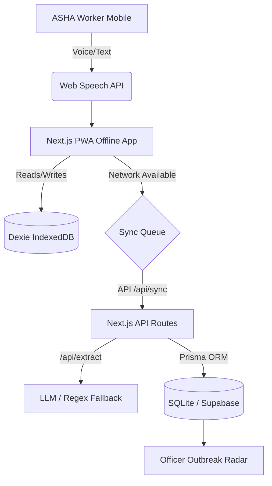

# ASHA-SAATHI
**An offline-first, voice-first copilot for ASHA/ANM community health workers.**

## 1. Overview
ASHA workers log visits on paper, often missing high-risk pregnancies, TB defaulters, and malnourished children. ASHA-SAATHI digitizes this process using a voice-first interface that works offline. It features an intelligent risk engine for the worker and a real-time outbreak radar for the health officer.

### Track: Healthcare & Community Well-being

## 2. Setup & Execution

### Prerequisites
- Node.js 18+

### Installation
```bash
git clone <repo>
cd asha-saathi
npm install
npx prisma db push
npm run dev
```

### Environment Variables
Create a `.env` file in the root:
```env
ANTHROPIC_API_KEY=your_key_here # Or GEMINI_API_KEY. (Optional: App falls back to local rules if not set)
```

## 3. Architecture



## 4. Key Features
1. **Voice Visit Logging:** ASHA worker taps mic and speaks normally.
2. **Offline-First:** Works fully offline; queues visits and syncs when online.
3. **Risk Engine:** Deterministic rule engine triggers Green/Amber/Red flags.
4. **Outbreak Radar:** Officer dashboard flags symptom clusters in real-time.

## 5. 90-Second Demo Script

- **0:00 - Problem:** (Show the app home page) "ASHA workers use paper registers. We built a voice-first offline app to fix this."
- **0:15 - Voice Log:** (Go to Log page, tap mic or use fallback) "Sunita devi, 7 months pregnant, BP is 150/96, having severe headache, Hb is 8."
- **0:35 - Risk Flag:** (Show extracted card) "Notice how it caught the high BP and headache, flagged it RED for possible pre-eclampsia, and offers a referral slip."
- **0:50 - Offline Mode:** (Toggle network offline) "If she loses connectivity, the app still works via IndexedDB." (Show offline chip).
- **1:10 - Officer Dashboard:** (Navigate to `/radar` directly) "Meanwhile, the health officer sees this radar."
- **1:25 - Simulate Outbreak:** (Click 'Inject Demo Outbreak' on Radar) "If cases spike, the anomaly detection engine catches the Dengue cluster instantly."
- **1:35 - Impact:** "From the village to the block, data flows instantly, saving lives."

## 6. Limitations & Ethics
- **Decision Support Only:** This is NOT a diagnostic tool. A disclaimer is shown.
- **Mocked Components:** Some features (like physical SMS gateway) are mocked for the demo. LLM extraction uses a local rule-based fallback if no API key is provided to ensure demo stability.
